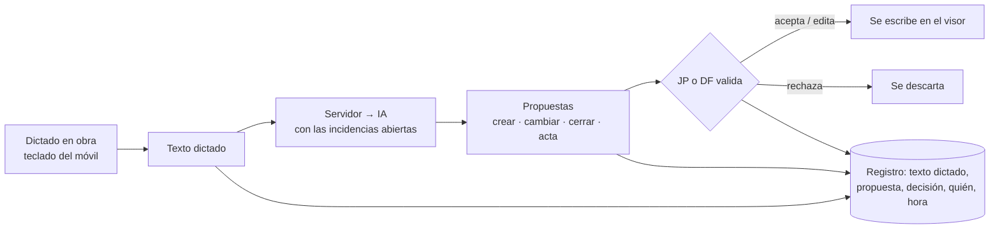
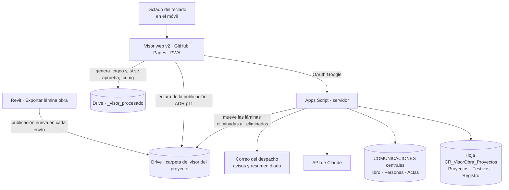

# CR_ESP_VisorObra_PO_v2.0 · Especificación del visor de obra v2

[BORRADOR IA — EN REVISIÓN]

| Campo | Valor |
|---|---|
| Documento | Especificación funcional del visor de obra CEL-RAS, versión 2 |
| Fase | PO (Proyecto en fase de Obra) |
| Responsable | BIM Manager |
| Estado | Cerrada en la parada 7 (27/11/2026) con los acuerdos de [docs/entrevista.md](../entrevista.md) y las medidas de `casos/`. Pendiente de aprobación |
| Revisión | [REVISADO POR: Nombre, YYYY-MM-DD] |

## TL;DR

El visor de obra es la web donde despacho, constructora, ingenierías y propiedad ven los planos y el modelo de una obra y se comunican sobre ellos. La v1 funciona, pero ha crecido a base de parches y es lenta la primera vez que se abre una obra grande.

La v2 se rehace con método, sin cambiar lo que ya va bien:

- **Mismo origen.** Los planos y modelos siguen saliendo de Revit, como hoy.
- **Mismos permisos.** Cada persona ve las obras que el jefe de proyecto le ha compartido en Drive, y con los mismos derechos que hoy.
- **Avisos.** Las órdenes y las incidencias urgentes llegan por correo al momento. El resto, en un resumen diario.
- **Móvil ligero.** En el móvil se ven las comunicaciones y sus imágenes. Los planos solo llegarán al móvil si una prueba demuestra que se abren en menos de 3 segundos. El modelo 3D, nunca.
- **Tablet y ordenador completos.**
- **Voz con IA.** El técnico dicta en obra con el teclado del móvil. La IA propone crear, cambiar o cerrar incidencias y redacta el acta de la visita. Nada se guarda hasta que el técnico lo valida.
- **Piloto interno.** Primero se prueba solo con gente del despacho.

## 1. Contexto y punto de partida

### 1.1 Qué hay hoy (v1)

```
Revit (pyRevit) · «Exportar lámina obra» v0.19 + «Publicar sin supervisión»
 └─ publica cada vez en una carpeta nueva AAAAMMDD_HHMM_VisorObra de la carpeta del visor (Drive)
      ├─ láminas: un PDF por lámina + JSON de localización plano↔modelo (_LOC.json)
      ├─ índice de la publicación (_INDICE.json)
      ├─ IFC del anfitrión + vínculos federados, con posiciones (_MODELO.json)
      ├─ _PROPS.json.gz (propiedades de Revit)
      └─ marca de publicación completa (lista de archivos y tamaños: todo o nada)

Generado por el visor, no por Revit
 └─ _visor_procesado/ : versión procesada del modelo (.crgeo)

Servidor · Apps Script «CR_VisorObra_Servidor» v0.16
 ├─ hoja CR_VisorObra_Proyectos (código · nombre · carpeta · activo · JP) + pestaña «Registro»
 └─ COMUNICACIONES centrales (libro, fichas PDF, adjuntos, capturas, copias diarias)

Visor web publicado · sw.js 0.21 · GitHub Pages · PWA (index.html + sw.js + manifest + icons/ + lib/)
```

- **Lo publicado:** el visor `sw.js` 0.21 (`index.html` no declara versión) y el servidor v0.16. Es lo que usan hoy las obras y lo que se midió en la parada 3.
- **Lo que se perdió:** la v0.23 del visor y el servidor v0.17. Se entregaron como zip y nunca se subieron a git (lección 22).
  - Con ellas se perdieron las láminas por teselas (`.crimg`), que generaba el visor, no Revit, y el aviso de versión nueva.
  - Detalle en [como-se-hace-hoy.md](../como-se-hace-hoy.md), apartado 16.

### 1.2 Por qué rehacerlo

- Todo el visor vive en un único `index.html`. Cada cambio arriesga romper otra parte.
- No hay pruebas automáticas; los fallos se descubren en obra.
- **Lentitud medida** con la v1 en CASO-F (ordenador, 26/11/2026, ver 5.1):
  - en frío, abrir el proyecto tarda 32 s, un plano 12,6 s y el modelo 9,6 min;
  - en caliente: 0,1 s, 2,1 s y 2,9 s.
  - **Hipótesis**, sin comprobar: lo que más pesa en frío es descargar unos 231 MB de modelo procesado a través de Apps Script.
- Sin cobertura no se puede guardar nada.
- Eliminar una lámina oculta todas las de su publicación (comprobado: ver CA-21).
- Faltan la voz con IA, el acta de obra y los avisos.

### 1.3 Qué se conserva

- El contrato de publicación de Revit, con el cambio de 4.2.
- Los permisos por carpeta de Drive y la hoja de proyectos.
- La carpeta central de COMUNICACIONES.
- El inicio de sesión con Google y el alojamiento en GitHub Pages.
- Las comunicaciones creadas con la v1 se tienen que poder leer en la v2 (CA-06).
- Qué parte de la v1 se reutiliza y cuál se reescribe: [rea-visor-obra.md](../rea-visor-obra.md), parte B.

## 2. Usuarios, permisos y roles

Hay dos capas. El **permiso** decide qué puede ver y hacer cada persona. El **rol** solo decide a quién se avisa.

### 2.1 Permisos

El permiso sale del nivel de cada persona o grupo de Google en la carpeta del visor del proyecto, igual que en la v1. El JP sale de la columna E de la hoja de proyectos. Un enlace público («cualquiera con el enlace») no da acceso.

| Nivel en Drive | Quién suele ser | Ve | Puede |
|---|---|---|---|
| Editor → **equipo** | JP y DF | Sus proyectos | Crear todo tipo de comunicaciones, órdenes incluidas; editar y cambiar el estado de cualquiera; devolver respuestas; validar propuestas de IA; generar actas |
| Comentarista → **agente** | Constructora, ingenierías y, si el JP quiere, propiedad | Proyectos compartidos | Crear incidencias y consultas, responder, subir adjuntos y pasar a «En curso» o «Respondida» lo que le toca |
| Lector → **consulta** | Propiedad | Proyectos compartidos | Ver y responder |
| **JP** (columna E, y además editor) | Jefe de proyecto | Sus proyectos | Lo del equipo, más organizar planos, eliminar láminas, eliminar comunicaciones y asignar roles |
| **BIM Manager** | — | Todo | Administrar proyectos y acceder al archivo central de COMUNICACIONES |

- Quien no tiene permiso no ve ni el nombre del proyecto (CA-01).
- **Consecuencias:**
  - las ingenierías pueden crear incidencias, igual que la constructora;
  - una DF externa al despacho tiene que ser editora de la carpeta del visor (ver riesgos).

### 2.2 Roles de notificación

- Cada persona o grupo con permiso puede tener un rol de esta lista, que es la de «Agente o disciplina» de la v1:
  - Arquitectura;
  - Dirección de ejecución;
  - Constructora;
  - Ing. estructuras;
  - Ing. instalaciones;
  - Propiedad / PM.
- La DF es Arquitectura + Dirección de ejecución; las ingenierías, estructuras + instalaciones.
- El rol JP sale de la columna E y el BIM Manager es fijo.
- **Pantalla «Personas»:** solo el JP. Lista a quien tiene permiso en la carpeta y le asigna un rol. Se guarda en una pestaña «Personas» del libro central del proyecto. Si dos JP guardan a la vez, se avisa y se recarga, como al organizar planos.
- Una comunicación dirigida a una disciplina avisa a todos los que tienen ese rol, además de a sus «Para» y «Copia».
- Quien no tiene rol solo recibe los avisos de lo que va a su nombre.

## 3. Alcance funcional

### 3.1 Núcleo (paridad con la v1)

- Lista de proyectos según permisos.
- Planos por versión, con su organización por carpetas.
- Modelo 3D federado con propiedades de Revit.
- Localización plano↔modelo.
- Comunicaciones: incidencias, consultas, órdenes, envíos y avisos, con nubes o capturas sobre plano, fotos y adjuntos. Tienen estados, responsable y plazo.
- Archivo central de comunicaciones con copia diaria.

### 3.2 Reglas de las comunicaciones

| Regla | Valor |
|---|---|
| Plazo por defecto | Incidencia, 2 días laborables; consulta, 3; orden, 2 (plazo para el acuse de recibo); envío y aviso, sin plazo. Quien crea la comunicación puede cambiarlo |
| Días laborables | De lunes a viernes, sin los festivos nacionales ni los de la comunidad autónoma del proyecto. Los festivos locales no se descuentan |
| Festivos | Pestaña «Festivos» de la hoja de proyectos, que el BIM Manager mantiene una vez al año. Columna nueva «Comunidad autónoma» en «Proyectos» |
| Devolver | DF y JP pueden devolver una respuesta: de «Respondida» a «Abierta», con comentario obligatorio en el hilo. El plazo vuelve a contar desde ese momento |
| Eliminar | Solo el JP, con motivo obligatorio. Queda en el registro y en el libro como «Eliminada». La DF puede cerrarlas, pero no eliminarlas |
| Avisos al momento | Las órdenes y las incidencias de prioridad Alta envían un correo a sus destinatarios y a los roles a los que van dirigidas, desde la cuenta del despacho |
| Resumen diario | Un correo al día por persona, solo si tiene algo: nuevas para ella o para su rol, pendientes de respuesta y vencidas. Con enlace directo a cada una, que pide entrar con Google y comprueba el permiso |

### 3.3 Modo por dispositivo

| | Ordenador | Tablet | Móvil |
|---|---|---|---|
| Planos | Sí | Sí (CA-11) | No, salvo que el prototipo pase el CA-22 |
| Modelo 3D | Sí | Sí (CA-11) | No |
| Comunicaciones | Sí | Sí | Sí |
| Imagen del plano de cada incidencia | Sí | Sí | Sí, recorte PNG |
| Imagen del modelo de cada incidencia | Sí | Sí | Sí, captura PNG |
| Dictado de notas | Sí | Sí | Sí |
| Sin cobertura | Abre lo ya cargado | Abre lo ya cargado | Lee y responde; envía al volver la red (CA-10) |

- **Detección.** El modo se elige por el ancho de pantalla, y el usuario puede pedir «versión completa» a mano (CA-12).
- **Recortes.** Al crear una incidencia sobre un plano o el modelo, se guarda una imagen del área de unos 1200 px. Es lo único que descarga el móvil mientras no tenga planos. Las capturas de 720 px de la v1 se siguen viendo.
- **Prototipo de planos en el móvil.**
  - En la construcción se prueba a servir las láminas por teselas (`.crimg`): el móvil solo pide los trozos que mira, con una función `range` del servidor. Es la idea de la v0.23 perdida (1.1).
  - Los planos se quedan en el móvil si se cumple el CA-22. Si no, el móvil sigue sin planos.
  - Los `.crimg` también sirven para la tablet si el CA-11 lo pide.
  - Quién los genera y cuándo: ADR de la parada 11.
- **Crear incidencias desde el móvil.** Decisión aplazada hasta el resultado del prototipo:
  - si el móvil tiene planos, se crean sobre el plano como en la tablet;
  - si no, se decide entonces cómo se crean sin plano.

### 3.4 Voz → propuestas → validación



1. **Dictar.** El técnico dicta con el teclado del móvil, en una nota asociada al proyecto y a la visita del día. Sin cobertura, la nota espera en la cola del dispositivo.
2. **Condición antes del piloto.** El dictado se tiene que hacer en el propio dispositivo (ver riesgos).
3. **Proponer.** El servidor envía el texto y las incidencias abiertas del proyecto, con su número, a la API de Claude. Recibe propuestas estructuradas:
   - crear una incidencia, con tipo, prioridad y disciplina;
   - cambiar o cerrar una existente, citando su número;
   - anotar una entrada de acta.
   El servidor comprueba que la incidencia citada existe y sigue abierta.
4. **Validar.** La bandeja «Propuestas IA» muestra cada propuesta junto al texto del que sale. Solo el equipo (JP y DF) la acepta, la edita o la rechaza (CA-13, CA-17).
5. **Registrar.** Se guardan el texto dictado tal cual, antes de que lo edite nadie, la propuesta, la decisión, quién la tomó y la hora. No se guarda audio (CA-16).

### 3.5 Acta de obra

- **Cuándo:** se genera al cerrar la visita, con las incidencias tocadas y las entradas de acta validadas.
- **Edición:**
  - se revisa y se edita en el visor;
  - para los textos largos, el botón «Editar en Google Docs» abre el texto en un documento; al volver, el visor recoge el texto editado.
- **PDF:**
  - se guarda en la carpeta central › `<proyecto>` › Actas › `<año>` › `AAAAMMDD_Acta_visita_NN.pdf`;
  - lleva la etiqueta `[BORRADOR IA — EN REVISIÓN]` hasta que el técnico la valida y añade `[REVISADO POR: Nombre, AAAA-MM-DD]`.
- **Quién la ve:** el borrador, solo JP y DF. Una vez validada, todos los que tienen permiso en el proyecto.
- **Plantilla, con estilo CEL-RAS:**
  1. cabecera CEL-RAS;
  2. datos de la visita (proyecto, fecha, hora y número de acta);
  3. asistentes;
  4. incidencias nuevas, cambiadas y cerradas, con su número;
  5. acuerdos e instrucciones (entradas de acta validadas);
  6. próxima visita;
  7. firma.

## 4. Arquitectura



### 4.1 Se decide en el ADR de la parada 11

- Estructura del código del visor: módulos separados con o sin paso de compilación. Recomendación: módulos ES sin compilación, para seguir publicando tal cual en GitHub Pages.
- Agrupar las llamadas al servidor al abrir un proyecto. Hoy, abrir CASO-F en frío tarda 32 s.
- Leer Drive directamente desde el navegador con el token OAuth, en lugar de pasar los archivos por Apps Script. Es la hipótesis de los 9,6 min del modelo en frío. Ojo: puede exigir el permiso de Drive en la app de Google (ver riesgos).
- Quién genera los `.crimg` y cuándo.
- Qué extrae del IFC `lib/ifc-worker.js` (P-13 de `como-se-hace-hoy.md`).

### 4.2 Publicación y láminas eliminadas

- **Eliminar una lámina**:
  - el servidor mueve su PDF y su `_LOC.json` a una subcarpeta `_eliminadas` dentro de su publicación, y lo anota en «Láminas eliminadas» del libro central;
  - al comprobar la marca de publicación completa, el visor descuenta lo anotado como eliminado, así que el resto de la publicación se sigue viendo (CA-21);
  - el visor no lee nada de `_eliminadas`.
- **PDF pesados** (cambio en «Exportar lámina obra», tarea aparte fuera de la v2; ver 7):
  - por encima de 30 MB, Revit reduce la resolución de las imágenes del PDF antes de publicar;
  - si sigue por encima, publica igual y lo anota en la marca;
  - el visor avisa de que es una lámina pesada (CA-29).
  - 30 MB es el límite que la v1 ya usa para no precargar.
  - Hoy, CASO-F tiene tres PDF de 197 a 260 MB.

## 5. Criterios de aceptación

Formato Dado / Cuando / Entonces. Cada criterio debe poder fallar y dice cómo se comprueba. Las pruebas se hacen en la copia de pruebas de CASO-F. Mientras el piloto sea solo interno, los usuarios externos se simulan con cuentas de pruebas del despacho con el permiso que corresponda.

### 5.1 Referencias medidas con la v1

**Ordenador.** Las medidas que la v2 no puede empeorar (CA-11):
- **Cuándo y dónde:** 26/11/2026, de 16:51 a 19:10. Ordenador del BIM Manager (Windows 11 Pro, Edge 158, ventana de 1440 × 900), con el cable del despacho.
- **Cómo:** Playwright desde fuera del visor (`casos/scripts/medir_v1.js`), con la v1 publicada.
  - **Frío:** se borra lo que el visor guarda en el navegador antes de cada repetición.
  - **Caliente:** justo después de una carga completa.
- **Qué se abre:** la lámina IE02-30 y la comunicación COM-0001.
- **Detalle:** [casos/medidas-ordenador.md](../../casos/medidas-ordenador.md).

| Acción | Frío: mediana (mín–máx) | Caliente: mediana (mín–máx) |
|---|---|---|
| Entrar con Google | 9,1 s (7,5–10,4), n = 7 | 4,5 s (4,2–4,5), n = 4 |
| Abrir proyecto | 32,1 s (23,2–36,2), n = 6 | 0,1 s (0,1–0,2), n = 4 |
| Abrir plano IE02-30 | 12,6 s (10,7–14,8), n = 3 | 2,1 s (2,0–2,1), n = 3 |
| Cargar modelo (38 vínculos, 257 copias) | 576,7 s ≈ 9,6 min (567,4–594,1), n = 6 | 2,9 s (2,6–3,3), n = 4 |

- Abrir COM-0001 tarda 0,1 s, pero esa comunicación no tiene capturas. No sirve de referencia para el CA-09.
- **Móvil y tablet:** sin medir todavía. Las anota el BIM Manager en [casos/medidas-dispositivos.md](../../casos/medidas-dispositivos.md).
- **Puntos de control plano↔modelo (CA-05):** sin anotar todavía. Van en [casos/caso-f.md](../../casos/caso-f.md).

### 5.2 Permisos

- **CA-01.** Dado un usuario sin permiso en CASO-F, cuando abre el visor, entonces CASO-F no aparece en su lista y la URL directa del proyecto devuelve «sin acceso». *Playwright con una cuenta de pruebas sin permiso.*
- **CA-02.** Dado un usuario con permiso de comentarista, cuando intenta eliminar un plano, entonces la opción no aparece y el servidor rechaza la llamada si se fuerza. *Playwright más una llamada directa al servidor.*
- **CA-03.** Dado un JP, cuando reorganiza las carpetas de planos, entonces los demás usuarios ven el mismo orden al recargar. *Dos sesiones de Playwright.*
- **CA-27.** Dado un editor que no es JP (DF), cuando intenta eliminar una comunicación, entonces la opción no aparece y el servidor la rechaza si se fuerza. Un JP sí puede, y solo con motivo. *Playwright con dos cuentas, más una llamada directa.*
- **CA-28.** Dado un JP, cuando asigna en «Personas» el rol «Constructora» a una cuenta, entonces una comunicación nueva dirigida a «Constructora» avisa a esa cuenta, aunque no esté en «Para». Una cuenta que no es JP no puede abrir «Personas». *Playwright y lectura del buzón de la cuenta de pruebas.*

### 5.3 Núcleo

- **CA-04.** Dado el paquete publicado de CASO-F, cuando se abre en la v2, entonces el número de láminas, de versiones y de modelos coincide con el recuento independiente: 584 láminas, 584 versiones y 2 modelos con 38 vínculos y 257 copias. *`casos/scripts/contar_paquete.py` sobre el listado de Drive; si el paquete cambia, se vuelve a contar.*
- **CA-05.** Dado un punto de control de un plano de CASO-F, cuando se pide su localización en el modelo, entonces la cámara va al mismo elemento que en la v1. *Los tres puntos de control de `casos/caso-f.md`, que el BIM Manager aún tiene que anotar.*
- **CA-06.** Dadas las comunicaciones de CASO-F creadas con la v1, cuando se abren en la v2, entonces se ven todas, con sus estados, respuestas y adjuntos. *Recuento contra el libro central.*
- **CA-07.** Dada una incidencia nueva sobre un plano, cuando se guarda, entonces aparece en el libro central y en su ficha PDF con el recorte del plano. *Lectura del libro central tras la prueba.*

### 5.4 Comunicaciones

- **CA-23.** Dada una orden o una incidencia de prioridad Alta, cuando se guarda, entonces sus destinatarios y los roles a los que va dirigida reciben un correo en menos de 5 min. Una incidencia de prioridad Media no envía correo al momento. *Buzones de cuentas de pruebas, anotando la hora.*
- **CA-24.** Dada una persona con comunicaciones nuevas, pendientes o vencidas, cuando se ejecuta el resumen diario, entonces recibe un único correo con un enlace a cada una. Una persona sin nada pendiente no recibe correo. Un enlace abierto con una cuenta sin permiso devuelve «sin acceso». *Ejecución forzada del resumen en el servidor de pruebas.*
- **CA-25.** Dada una incidencia «Respondida», cuando la DF la devuelve, entonces pasa a «Abierta», el hilo guarda el comentario y el plazo vuelve a contar desde ese día. Sin comentario no se puede devolver, y un comentarista no ve el botón. *Playwright.*
- **CA-26.** Dada una incidencia creada el día laborable anterior a un festivo nacional o de la comunidad del proyecto, cuando se calcula su plazo, entonces el festivo no cuenta. *Prueba con fecha fija y la pestaña «Festivos» de pruebas.*

### 5.5 Móvil, tablet y sin cobertura

- **CA-08.** Dado un móvil, cuando abre CASO-F, entonces no descarga ningún PDF, IFC ni `.crgeo`. Solo descarga `.crimg` si el CA-22 se ha cumplido y el móvil tiene planos. *Registro de red de Playwright en tamaño móvil.*
- **CA-09.** Dado un móvil con 4G, cuando abre una incidencia con recorte, entonces se ve con su recorte en menos de 3 s. *Medido en un iPhone y un Android reales, anotando la red. La referencia de la v1 está por medir con una incidencia que tenga capturas.*
- **CA-10.** Dado un móvil sin cobertura, cuando responde a una incidencia o dicta una nota, entonces se guarda en local y se envía sola al volver la red, sin duplicarse. *Playwright en modo sin conexión, con reenvío forzado del mismo elemento.*
- **CA-11.** Dada una tablet, cuando abre CASO-F en versión completa, entonces el plano IE02-30 y el modelo cargan en menos tiempo que con la v1 en esa misma tablet, en frío y en caliente. Si no, la tablet pasa a modo ligero. *Medido en la tablet de obra, anotando dispositivo, red y hora. La referencia de la v1 en la tablet está por medir; en ordenador es la de 5.1.*
- **CA-12.** Dado un usuario con el móvil, cuando pulsa «versión completa», entonces ve planos y modelo. *Playwright.*
- **CA-22.** Dado un iPhone y un Android reales con 4G, cuando se abre la lámina IE02-30 de CASO-F con el prototipo de teselas, entonces se ve nítida en menos de 3 s y el zoom responde sin saltos. Si no se cumple en los dos, el móvil sigue sin planos. *Tres repeticiones por móvil, anotando dispositivo, red y hora.*

### 5.6 Voz e IA

- **CA-13.** Dada una nota dictada que pide crear una incidencia, cuando se procesa, entonces aparece una propuesta en la bandeja y no se crea nada hasta que el técnico la acepta. *Servidor de pruebas y un texto dictado fijo.*
- **CA-14.** Dada una nota que menciona una incidencia abierta, cuando se procesa, entonces la propuesta se refiere a esa incidencia por su número. *Diez notas de prueba con la respuesta esperada escrita antes.*
- **CA-15.** Dadas diez notas de prueba, cuando se procesan, entonces al menos 8 propuestas se aceptan sin editar. *Recuento en el registro.*
- **CA-16.** Dada una propuesta rechazada, cuando se consulta el registro, entonces constan el texto dictado original, la propuesta, la decisión, quién la tomó y la hora. *Lectura del registro.*
- **CA-17.** Dado un usuario con permiso de comentarista, cuando intenta validar una propuesta de IA, entonces no puede, y el servidor rechaza la llamada si se fuerza. *Playwright más una llamada directa.*

### 5.7 Acta

- **CA-18.** Dada una visita con incidencias tocadas y entradas de acta validadas, cuando se genera el acta, entonces:
  - recoge todas;
  - lleva la etiqueta de borrador;
  - solo la ven JP y DF hasta que se valida;
  - una vez validada, el PDF queda en la carpeta central › Actas › `<año>` y lo ven todos los que tienen permiso.
  *Comparación con la lista de la visita y Playwright con una cuenta de comentarista.*
- **CA-30.** Dado un borrador de acta, cuando el técnico edita un texto en Google Docs y vuelve al visor, entonces el visor muestra el texto editado y el PDF lo incluye. *Playwright y lectura del PDF generado.*

### 5.8 Fiabilidad y publicación

- **CA-19.** Dada una publicación incompleta (sin marca), cuando se abre el proyecto, entonces el visor sigue mostrando la última publicación completa y avisa. *Paquete de prueba sin marca.*
- **CA-20.** Dado cualquier error del servidor, cuando ocurre, entonces el usuario ve un mensaje entendible y el error queda registrado con hora y usuario. *Error forzado en el servidor de pruebas.*
- **CA-21.** Dada una publicación completa de CASO-F con varias láminas, cuando el JP elimina una de ellas, entonces:
  - su PDF y su `_LOC.json` pasan a `_eliminadas`;
  - el resto de láminas de esa publicación se siguen viendo;
  - solo desaparece la eliminada.
  - Además, en la publicación 20261028_1242, eliminada con la v1, se vuelven a ver sus 5 láminas restantes.
  *Playwright en la copia de pruebas: recuento de láminas antes y después.* En la v1 sí la invalida: ver `casos/caso-f.md`.
- **CA-29.** Dada una publicación con un PDF que, tras reducirlo, sigue pasando de 30 MB, cuando se abre esa lámina, entonces el visor avisa de que es una lámina pesada antes de descargarla. *Paquete de prueba con un PDF grande, cuando exista el cambio en Revit.*

## 6. Riesgos conocidos

| Riesgo | Efecto | Primera respuesta |
|---|---|---|
| Latencia de Apps Script | Abrir CASO-F en frío tarda 32 s con la v1 (5.1) | Agrupar llamadas (ADR p11) y medir con la v2 en las mismas condiciones |
| Drive a través de Apps Script no es una CDN | El modelo de CASO-F tarda 9,6 min en frío con la v1 (5.1). Hipótesis: la descarga de ≈ 231 MB por el servidor | Medir la descarga directa desde Drive; lectura directa con token (ADR p11); caché de versiones publicadas |
| Federación de CASO-F: 2 modelos con 38 vínculos y 257 copias | Memoria y tiempo en tablet | Carga por modelo; medir pronto en la tablet (CA-11) |
| **Dictado fuera del dispositivo** | Con el dictado del teclado, la voz puede ir a Apple o Google fuera de la cuenta del despacho, en contra de la regla de datos de `AGENTS.md` | **Condición antes del piloto:** comprobar en la documentación de Apple y Google que el dictado se puede hacer en el propio dispositivo, y configurarlo así en los móviles del piloto. Si no se puede garantizar, no hay dictado en el piloto hasta que decida el BIM Manager |
| Inicio de sesión de Google en iPhone | Usuarios sin acceso en obra | Probar en un iPhone real en el primer paso (lección 7) |
| App de Google en modo prueba | El piloto solo admite cuentas del despacho: no se prueba con constructora ni ingenierías reales | Simular los permisos externos con cuentas internas de pruebas; publicar la app después del piloto |
| Permiso de Drive en la app de Google | Si la lectura directa de Drive añade ese permiso, publicar la app exigiría la verificación de Google | Tenerlo en cuenta en el ADR de la parada 11 |
| DF externa al despacho | Como editora de la carpeta del visor, puede modificar o borrar archivos de la publicación en Drive | Dar a la DF externa el mínimo necesario y vigilarlo en el registro. Se revisa tras el piloto |
| «Exportar lámina obra» y `_eliminadas` | **Comprobado en el script v0.19** (`script.py:1747-1753`): cada publicación crea su carpeta y nunca escribe en las anteriores, así que no toca `_eliminadas`. **Pero** con la opción «nuevas o con revisión cambiada» (`published_sheets`, `script.py:1382-1429`), una lámina cuyo PDF no está en su carpeta cuenta como no publicada: Revit volvería a proponer y publicar las láminas eliminadas | Cambio en Revit, en una tarea aparte: que `published_sheets` cuente también los PDF de `_eliminadas` como publicados. Hasta entonces, el JP revisa la lista que propone Revit antes de publicar |
| PDF de 197–260 MB en CASO-F | Lámina lenta o imposible en tablet y móvil | Reducción a 30 MB en Revit (4.2), en una tarea aparte; aviso de lámina pesada (CA-29) |
| Calidad del dictado con ruido de obra | Propuestas pobres | Medir con las diez notas del CA-15. Plan B: transcripción en el servidor (Google Speech-to-Text) |
| Coste de la API de Claude | Gasto no previsto | Límite mensual y registro de uso por proyecto |
| Cupo de correo de Apps Script | Avisos que no salen en obras con mucha actividad | Solo órdenes y prioridad Alta al momento; el resto, en el resumen diario. Registrar los envíos fallidos |
| Cambio de dominio futuro (<dominio propio del despacho>) | Reinstalar la PWA y rehacer OAuth | Decidirlo antes del despliegue |

## 7. Fuera de alcance de la v2

- Editar o corregir los modelos o los planos desde el visor.
- Presupuestos, mediciones y certificaciones.
- Detección de colisiones.
- Cambiar el contrato de publicación de Revit. Los dos cambios acordados van en tareas aparte:
  - reducir los PDF de más de 30 MB;
  - contar `_eliminadas` como publicado.
- Mover los archivos pesados a otro almacenamiento con CDN. Se estudia en 2027 con las medidas de la v2.
- La migración a la cuenta dedicada <cuenta dedicada del despacho>.
- Plantillas de incidencia («sellos»). Se proponen cuando la v2 esté validada.
- Publicar la app de Google para usuarios externos: después del piloto.

## 8. Lo que falta para empezar a construir

Las preguntas de la entrevista están cerradas ([docs/entrevista.md](../entrevista.md)). Quedan datos y comprobaciones, no decisiones:

1. Medidas de la v1 en iPhone, Android y tablet: las anota el BIM Manager (CA-09, CA-11).
2. Los tres puntos de control plano↔modelo de CASO-F: los anota el BIM Manager (CA-05).
3. Una incidencia con capturas en la copia de pruebas, para tener la referencia del CA-09.
4. Antes del piloto, la condición del dictado en el dispositivo (riesgos).
5. Lo que decide el ADR de la parada 11 (4.1).
