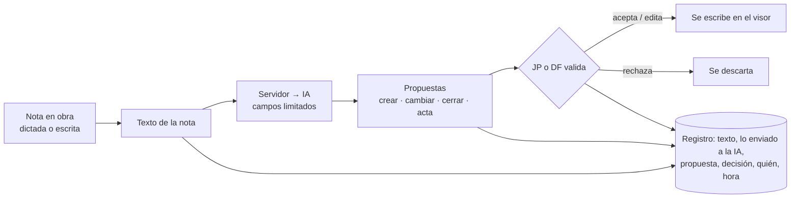
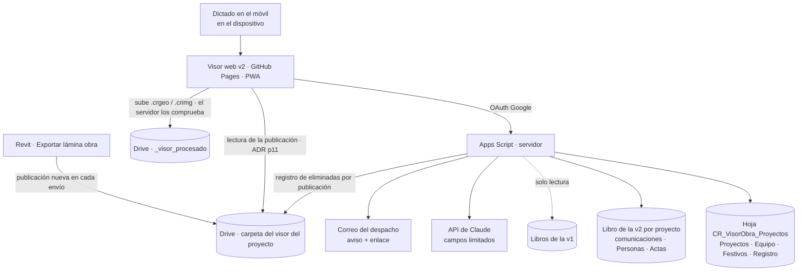

# CR_ESP_VisorObra_PO_v2.0 · Especificación del visor de obra v2

[BORRADOR IA — EN REVISIÓN]

| Campo | Valor |
|---|---|
| Documento | Especificación funcional del visor de obra CEL-RAS, versión 2 |
| Fase | PO (Proyecto en fase de Obra) |
| Responsable | BIM Manager |
| Estado | Cerrada en la parada 7 (27/11/2026) con [docs/entrevista.md](../entrevista.md) y las medidas de `casos/`. Revisada el 27/11/2026 con los puntos ROJO y NARANJA del abogado del diablo (parada 8). Pendiente de aprobación |
| Revisión | [REVISADO POR: Nombre, YYYY-MM-DD] |

## TL;DR

El visor de obra es la web donde despacho, constructora, ingenierías y propiedad ven los planos y el modelo de una obra y se comunican sobre ellos. La v1 funciona, pero ha crecido a base de parches y es lenta la primera vez que se abre una obra grande.

La v2 se rehace con método, sin cambiar lo que ya va bien:

- **Mismo origen.** Los planos y modelos siguen saliendo de Revit, como hoy.
- **Mismos permisos, más control.** Cada persona ve las obras que el jefe de proyecto le ha compartido. Solo las personas que el jefe de proyecto apunta como equipo pueden dar órdenes y validar.
- **Avisos.** Las órdenes y las incidencias urgentes llegan por correo al momento. El resto, en un resumen diario. Los correos no llevan el contenido, solo el aviso y el enlace.
- **Móvil ligero.** En el móvil se ven las comunicaciones y sus imágenes. Los planos solo llegarán al móvil si una prueba demuestra que se abren en menos de 3 segundos. El modelo 3D, nunca.
- **Tablet y ordenador completos.**
- **Voz con IA.** El técnico dicta en obra con el teclado del móvil. La IA propone crear, cambiar o cerrar incidencias y redacta el acta de la visita. Nada se guarda hasta que el técnico lo valida.
- **Piloto interno y separado.** Primero se prueba solo con gente del despacho, con copias de las obras y con sus comunicaciones aparte de las de la v1.

## 1. Contexto y punto de partida

### 1.1 Qué hay hoy (v1)

```
Revit (pyRevit) · «Exportar lámina obra» v0.19 + «Publicar sin supervisión»
 └─ publica cada vez en una carpeta nueva AAAAMMDD_HHMM_VisorObra de la carpeta del visor (Drive)
      ├─ láminas: un PDF por lámina + JSON de localización plano↔modelo (_LOC.json)
      ├─ índice de la publicación (_INDICE.json)
      ├─ IFC del anfitrión + vínculos federados, con posiciones (_MODELO.json)
      ├─ _PROPS.json.gz (propiedades de Revit)
      └─ marca de publicación completa (lista de archivos y tamaños: todo o nada)

Generado por el visor, no por Revit
 └─ _visor_procesado/ : versión procesada del modelo (.crgeo)

Servidor · Apps Script «CR_VisorObra_Servidor» v0.16
 ├─ hoja CR_VisorObra_Proyectos (código · nombre · carpeta · activo · JP) + pestaña «Registro»
 └─ COMUNICACIONES centrales (libro, fichas PDF, adjuntos, capturas, copias diarias)

Visor web publicado · sw.js 0.21 · GitHub Pages · PWA (index.html + sw.js + manifest + icons/ + lib/)
```

- **Lo publicado:** el visor `sw.js` 0.21 (`index.html` no declara versión) y el servidor v0.16. Es lo que usan hoy las obras y lo que se midió en la parada 3.
- **Lo que se perdió:** la v0.23 del visor y el servidor v0.17. Se entregaron como zip y nunca se subieron a git (lección 22).
  - Con ellas se perdieron las láminas por teselas (`.crimg`), que generaba el visor, no Revit, y el aviso de versión nueva.
  - Detalle en [como-se-hace-hoy.md](../como-se-hace-hoy.md), apartado 16.
- **Marcas de publicación:** Revit escribe la señal «en curso» y la marca de publicación completa desde el 27/10/2026. Es la primera que aparece en los listados de CASO-F y CASO-P. Las carpetas anteriores no tienen marcas: son publicaciones antiguas.

### 1.2 Por qué rehacerlo

- Todo el visor vive en un único `index.html`. Cada cambio arriesga romper otra parte.
- No hay pruebas automáticas; los fallos se descubren en obra.
- **Lentitud medida** con la v1 en CASO-F (ordenador, 26/11/2026, ver 5.1):
  - en frío, abrir el proyecto tarda 32 s, un plano 12,6 s y el modelo 9,6 min;
  - en caliente: 0,1 s, 2,1 s y 2,9 s.
  - **Hipótesis**, sin comprobar: lo que más pesa en frío es descargar unos 231 MB de modelo procesado a través de Apps Script.
- Sin cobertura no se puede guardar nada.
- Eliminar una lámina oculta todas las de su publicación (comprobado: ver CA-21).
- Faltan la voz con IA, el acta de obra y los avisos.

### 1.3 Qué se conserva

- El contrato de publicación de Revit. La v2 solo añade un registro de eliminadas por publicación (4.2).
- Los permisos por carpeta de Drive y la hoja de proyectos, con las columnas nuevas de 2.1 y 3.2.
- La carpeta central de COMUNICACIONES.
- El inicio de sesión con Google y el alojamiento en GitHub Pages.
- Las comunicaciones creadas con la v1 se tienen que poder leer en la v2 (CA-06). La v2 no escribe en los libros de la v1 (3.6).
- Qué parte de la v1 se reutiliza y cuál se reescribe: [rea-visor-obra.md](../rea-visor-obra.md), parte B.

## 2. Usuarios, permisos y roles

Hay dos capas. El **permiso** decide qué puede ver y hacer cada persona. El **rol** solo decide a quién se avisa.

### 2.1 Permisos

El permiso sale de dos fuentes:
- el nivel de cada persona o grupo de Google en la carpeta del visor del proyecto, como en la v1;
- la hoja de proyectos: columna E (JP) y una columna nueva **«Equipo»**, con los correos de la DF y del resto del equipo del despacho que pueden emitir órdenes y validar.

Un enlace público («cualquiera con el enlace») no da acceso.

| Nivel | Cómo se consigue | Quién suele ser | Puede |
|---|---|---|---|
| **Equipo** | Estar en la columna «Equipo» o ser JP, **y** tener al menos permiso de comentarista en la carpeta | JP y DF, también la DF externa | Crear todo tipo de comunicaciones, órdenes incluidas; editar y cambiar el estado de cualquiera; devolver respuestas; validar propuestas de IA; generar actas |
| **Agente** | Comentarista, o editor, en Drive, sin estar en «Equipo» | Constructora, ingenierías y, si el JP quiere, propiedad | Crear incidencias y consultas, responder, subir adjuntos y pasar a «En curso» o «Respondida» lo que le toca |
| **Consulta** | Lector en Drive | Propiedad | Ver y responder |
| **JP** | Columna E, y además equipo | Jefe de proyecto | Lo del equipo, más organizar planos, eliminar láminas, eliminar comunicaciones y asignar roles |
| **BIM Manager** | — | — | Administrar proyectos y acceder al archivo central de COMUNICACIONES |

- Quien no tiene permiso no ve ni el nombre del proyecto (CA-01).
- **Ser editor de Drive ya no da el nivel equipo.** Un editor que no está en «Equipo» es agente. Lo mismo pasa con los miembros de la unidad compartida que heredan el permiso.
- **La DF externa** se da de alta en «Equipo» y como comentarista en Drive. No necesita ser editora, así que no puede tocar los archivos de la publicación fuera del visor.
- **Las carpetas del visor** se configuran para que los editores no puedan cambiar los permisos ni compartir la carpeta (CA-31).
- **Consecuencia:** las ingenierías pueden crear incidencias, igual que la constructora.
- **Perder el permiso** (CA-32):
  - el servidor comprueba el permiso al recibir cada elemento de la cola sin red; lo que rechaza se le dice al usuario, no se pierde en silencio;
  - cuando el servidor responde «sin permiso», el visor borra la caché y la cola de ese proyecto en el dispositivo;
  - los avisos y el resumen diario vuelven a comprobar el permiso al enviar;
  - con red, el cambio de permiso se aplica en 5 min como máximo, que es el tiempo de caché de permisos de la v1.

### 2.2 Roles de notificación

- Cada persona o grupo con permiso puede tener un rol de esta lista, que es la de «Agente o disciplina» de la v1:
  - Arquitectura;
  - Dirección de ejecución;
  - Constructora;
  - Ing. estructuras;
  - Ing. instalaciones;
  - Propiedad / PM.
- La DF es Arquitectura + Dirección de ejecución; las ingenierías, estructuras + instalaciones.
- El rol JP sale de la columna E y el BIM Manager es fijo.
- **Pantalla «Personas»:** solo el JP. Lista a quien tiene permiso en la carpeta y le asigna un rol. Se guarda en una pestaña «Personas» del libro del proyecto. Si dos JP guardan a la vez, se avisa y se recarga, como al organizar planos.
- Una comunicación dirigida a una disciplina avisa a todos los que tienen ese rol y siguen con permiso, además de a sus «Para» y «Copia».
- Quien no tiene rol solo recibe los avisos de lo que va a su nombre.

## 3. Alcance funcional

### 3.1 Núcleo (paridad con la v1)

- Lista de proyectos según permisos.
- Planos por versión, con su organización por carpetas.
- Modelo 3D federado o único, con propiedades de Revit.
- Localización plano↔modelo.
- Comunicaciones: incidencias, consultas, órdenes, envíos y avisos, con nubes o capturas sobre plano, fotos y adjuntos. Tienen estados, responsable y plazo.
- Archivo central de comunicaciones con copia diaria.

### 3.2 Reglas de las comunicaciones

| Regla | Valor |
|---|---|
| Numeración | `<código del proyecto>-COM-NNNN`, correlativo por proyecto y asignado por el servidor (por ejemplo, `CASO-F-COM-0001`). Así no se repite entre obras. Las comunicaciones de la v1 conservan su número (`COM-0001`, `INC-001`…) y el visor siempre las enseña con el código del proyecto delante |
| Plazo por defecto | Incidencia, 2 días laborables; consulta, 3; orden, 2 (plazo para el acuse de recibo); envío y aviso, sin plazo. Quien crea la comunicación puede cambiarlo |
| Días laborables | De lunes a viernes, sin los festivos nacionales ni los de la comunidad autónoma del proyecto. Los festivos locales no se descuentan |
| Festivos | Pestaña «Festivos» de la hoja de proyectos, que el BIM Manager mantiene una vez al año. Columna nueva «Comunidad autónoma» en «Proyectos» |
| Devolver | DF y JP pueden devolver una respuesta: de «Respondida» a «Abierta», con comentario obligatorio en el hilo. El plazo vuelve a contar desde ese momento |
| Eliminar | Solo el JP, con motivo obligatorio. Queda en el registro y en el libro como «Eliminada». La DF puede cerrarlas, pero no eliminarlas |
| Sin situar | Toda incidencia creada sin plano (por una propuesta de IA aceptada o, si se decide así, desde el móvil) nace «Sin situar», con la lámina como dato opcional. Sale en un filtro propio hasta que alguien del equipo le pone la nube |
| Avisos al momento | Las órdenes y las incidencias de prioridad Alta envían un correo a sus destinatarios y a los roles a los que van dirigidas |
| Resumen diario | Un único correo al día por persona, con todos sus proyectos, solo si tiene algo: nuevas para ella o para su rol, pendientes de respuesta y vencidas |
| Contenido del correo | Solo número, tipo, plazo y enlace directo. Sin asunto de la comunicación, descripción, imágenes ni adjuntos. El enlace pide entrar con Google y comprueba el permiso |
| Envío del correo | Desde la cuenta del despacho que ejecuta el servidor. Los destinatarios se recalculan con el permiso en el momento de enviar. Lo que falla se reintenta al día siguiente y queda en el registro |

### 3.3 Modo por dispositivo

| | Ordenador | Tablet | Móvil |
|---|---|---|---|
| Planos | Sí | Sí (CA-11) | No, salvo que el prototipo pase el CA-22 |
| Modelo 3D | Sí | Sí (CA-11) | No, nunca |
| Comunicaciones | Sí | Sí | Sí |
| Imagen del plano de cada incidencia | Sí | Sí | Sí, recorte PNG |
| Imagen del modelo de cada incidencia | Sí | Sí | Sí, captura PNG |
| Notas de voz | Se escriben | Se escriben | Dictado del teclado, solo en los móviles del piloto configurados (3.4) |
| Sin cobertura | Abre lo ya cargado | Abre lo ya cargado; lee, responde y escribe notas; envía al volver la red | Lee, responde y dicta; envía al volver la red (CA-10) |

- **Detección.** El modo se elige por el lado corto de la pantalla, no por el ancho, para que una tablet en vertical no se tome por un móvil. Valor inicial: menos de 600 px es móvil; se comprueba con los dispositivos del piloto.
- **«Versión completa» en el móvil** (CA-12): da los planos si el CA-22 se ha cumplido. Nunca da el modelo 3D.
- **Recortes.** Al crear una incidencia sobre un plano o el modelo, se guarda una imagen del área de unos 1200 px. Es lo único que descarga el móvil mientras no tenga planos. Las capturas de 720 px de la v1 se siguen viendo.
- **Prototipo de planos en el móvil.**
  - En la construcción se prueba a servir las láminas por teselas (`.crimg`): el móvil solo pide los trozos que mira, con una función `range` del servidor. Es la idea de la v0.23 perdida (1.1).
  - Los planos se quedan en el móvil si se cumple el CA-22. Si no, el móvil sigue sin planos.
  - Los `.crimg` también sirven para la tablet si el CA-11 lo pide.
  - Quién los genera y cuándo: ADR de la parada 11.
- **Crear incidencias desde el móvil.** Decisión aplazada hasta el resultado del prototipo:
  - si el móvil tiene planos, se crean sobre el plano como en la tablet;
  - si no, se decide entonces. Si se crean sin plano, nacen «Sin situar» (3.2).
- **Cola sin red y conflictos** (CA-10, CA-33). Móvil y tablet tienen la misma cola.
  - Los comentarios de la cola siempre se añaden al hilo.
  - Un cambio de estado de la cola solo se aplica si el estado no ha cambiado desde que se guardó en el dispositivo. Si ha cambiado, entra como comentario y se avisa a quien lo hizo.
  - Las notas llevan la hora en que se escribieron o dictaron y la visita a la que pertenecen, aunque se envíen otro día.
- **Si la tablet falla el CA-11:** el BIM Manager decide entre pasarla a modo ligero o seguir optimizando. El criterio no se da por cumplido en ningún caso.

### 3.4 Voz → propuestas → validación



1. **Dictar o escribir.**
   - En los móviles del piloto, el técnico dicta con el teclado. En ordenador y tablet, la nota se escribe.
   - La nota va asociada al proyecto y a la visita del día.
   - Sin cobertura, espera en la cola del dispositivo.
2. **Condición antes del piloto.** El dictado se hace en el propio dispositivo (ver riesgos). La web no puede comprobarlo, así que solo se permite en los móviles del piloto que estén configurados así.
3. **Proponer.**
   - El servidor envía a la API de Claude el texto de la nota y una lista cerrada de campos de las incidencias abiertas del proyecto: número, tipo, estado, asunto, lámina y disciplina.
   - No se envían correos, nombres de personas, descripciones ni adjuntos.
   - Límite: las 100 incidencias abiertas más recientes y 8.000 caracteres de nota. Son valores iniciales y se revisan con el CA-15.
   - Recibe propuestas estructuradas:
     - crear una incidencia, con tipo, prioridad y disciplina;
     - cambiar o cerrar una existente, citando su número completo con el código del proyecto;
     - anotar una entrada de acta;
     - o «no es de este proyecto».
   - El servidor comprueba que la incidencia citada es de ese proyecto, existe y sigue abierta.
4. **Validar.**
   - La bandeja «Propuestas IA» muestra cada propuesta junto al texto del que sale y, si cita una incidencia, su asunto y su lámina, para que se vea si es la que toca.
   - Solo el equipo (JP y DF) la acepta, la edita o la rechaza (CA-13, CA-17).
   - Una incidencia creada así nace «Sin situar» (3.2).
5. **Registrar.** Se guardan:
   - el texto de la nota tal cual, antes de que lo edite nadie;
   - por cada llamada a la IA: quién, proyecto, hora, tamaño y la lista de lo enviado;
   - la propuesta, la decisión, quién la tomó y la hora.
   - No se guarda audio (CA-16).

### 3.5 Acta de obra

- **Cuándo:** se genera al cerrar la visita, con las incidencias tocadas y las entradas de acta validadas.
- **Edición:**
  - se revisa y se edita en el visor;
  - para los textos largos, el botón «Editar en Google Docs» abre el texto en un documento.
- **Ese documento:**
  - lo crea el servidor en la carpeta central › `<proyecto>` › Actas › borradores, y lo comparte solo con quien edita;
  - al volver al visor, el servidor recoge el texto, quita el acceso y manda el documento a la papelera.
- **PDF:**
  - se guarda en la carpeta central › `<proyecto>` › Actas › `<año>` › `AAAAMMDD_Acta_visita_NN.pdf`;
  - lleva la etiqueta `[BORRADOR IA — EN REVISIÓN]` hasta que el técnico la valida y añade `[REVISADO POR: Nombre, AAAA-MM-DD]`.
- **Quién la ve:** el borrador, solo JP y DF. Una vez validada, todos los que tienen permiso en el proyecto.
- **Plantilla, con estilo CEL-RAS:**
  1. cabecera CEL-RAS;
  2. datos de la visita (proyecto, fecha, hora y número de acta);
  3. asistentes;
  4. incidencias nuevas, cambiadas y cerradas, con su número;
  5. acuerdos e instrucciones (entradas de acta validadas);
  6. próxima visita;
  7. firma.

### 3.6 Piloto y convivencia con la v1

- **Durante el piloto, la v2 escribe en un libro de comunicaciones propio por proyecto.** La v1 y la v2 nunca escriben en el mismo libro.
- La v2 lee los libros de la v1 solo para enseñar las comunicaciones antiguas (CA-06). No los modifica.
- La numeración con el código del proyecto (3.2) evita que se repitan números entre el libro de la v1 y el de la v2.
- **El paso a producción**, cuando una obra deja la v1 y su libro pasa a ser el de la v2, lo decide el BIM Manager después del piloto, obra por obra.

## 4. Arquitectura



### 4.1 Se decide en el ADR de la parada 11

- Estructura del código del visor: módulos separados con o sin paso de compilación. Recomendación: módulos ES sin compilación, para seguir publicando tal cual en GitHub Pages.
- Agrupar las llamadas al servidor al abrir un proyecto. Hoy, abrir CASO-F en frío tarda 32 s.
- Leer Drive directamente desde el navegador con el token OAuth, en lugar de pasar los archivos por Apps Script. Es la hipótesis de los 9,6 min del modelo en frío. Ojo: puede exigir el permiso de Drive en la app de Google (ver riesgos).
- Quién genera los `.crimg` y cuándo.
- Qué extrae del IFC `lib/ifc-worker.js` (P-13 de `como-se-hace-hoy.md`).
- **Archivos procesados** (`.crgeo`, `.crimg`):
  - el servidor comprueba la cabecera, la versión de formato y el tamaño antes de aceptarlos;
  - el nombre lleva la versión de formato de la v2, distinta del `_v1.crgeo` de la v1, para no romper a la v1;
  - solo los sube el equipo, nunca un agente ni una consulta.

### 4.2 Publicación y láminas eliminadas

- **Eliminar una lámina** (solo el JP, CA-21):
  - El servidor la anota en un **registro de eliminadas de la publicación**: un archivo `AAAAMMDD_HHMMSS_VisorObra_ELIMINADAS.json` dentro de la carpeta de esa publicación, con el origen, el número de lámina como texto, la revisión, los archivos, el alcance, el motivo, quién y cuándo.
  - Además, deja una fila en «Láminas eliminadas» del libro de la v2.
  - **No mueve ni borra el PDF ni su `_LOC.json`.** El visor no muestra ni descarga lo anotado.
  - Como el PDF sigue en su sitio, «Exportar lámina obra» la sigue contando como publicada (`script.py:1419-1428`) y no la vuelve a proponer con la opción «nuevas o con revisión cambiada».
- **Clave del descuento:**
  - lo eliminado se identifica por origen, número de lámina como texto y publicación, y por los nombres de archivo que salen del `pdf_file` del índice o del `_LOC.json`;
  - nunca por la columna «Lámina» del libro, que en la v1 guardó «00» como 0;
  - de la v1 se leen, solo para leer, las filas de «Láminas eliminadas», con su columna «clave» (JSON con origen, número y ruta) y la de archivos. Así cuenta también lo que la v1 mandó a la papelera.
- **Marca de publicación:** al comprobarla, el visor descuenta los archivos eliminados. Una publicación a la que solo le faltan archivos eliminados sigue completa.
- **Alcance «lámina entera»:** oculta también las publicaciones posteriores de esa lámina con la misma revisión. Si llega una revisión nueva, se muestra y se avisa al JP.
- **Lámina eliminada con comunicaciones abiertas** (CA-34):
  - antes de eliminar, el visor avisa al JP de las comunicaciones abiertas de esa lámina;
  - después, esas comunicaciones se siguen viendo con su recorte y la marca «lámina eliminada», y cuentan en la versión vigente que quede.
- **PDF pesados** (cambio en «Exportar lámina obra», tarea aparte fuera de la v2; ver 7):
  - por encima de 30 MB, Revit reduce la resolución de las imágenes del PDF antes de publicar;
  - si sigue por encima, publica igual y lo anota en la marca;
  - el visor avisa de que es una lámina pesada (CA-29).
  - 30 MB es el límite que la v1 ya usa para no precargar. Hoy, CASO-F tiene tres PDF de 197 a 260 MB.

## 5. Criterios de aceptación

Formato Dado / Cuando / Entonces. Cada criterio debe poder fallar y dice cómo se comprueba.

### 5.0 Entorno y casos de prueba

- **Copia de pruebas** de un caso:
  - copia completa de la carpeta del visor del proyecto (todas sus publicaciones, también las antiguas, en curso e incompletas, y `_visor_procesado`);
  - copia de su libro de comunicaciones;
  - hoja de proyectos de pruebas que apunta a esas copias;
  - servidor de pruebas.
  - Se crea en el paso previo del apartado 8.
- **Antes del piloto, la v2 no escribe en ninguna carpeta del visor ni en ningún libro de producción.**
- **Casos de prueba:**
  - **CASO-F**: grande y federado. 2 modelos de origen con 38 vínculos y 257 copias; 589 láminas con una versión cada una; publicaciones con marca, en curso, incompleta y antiguas. Detalle en `casos/caso-f.md`.
  - **CASO-P**: pequeño. 19 láminas con 3 versiones cada una; un solo modelo sin vínculos; 3 publicaciones antiguas, una sin índice; una incidencia de la v1 con capturas y numeración antigua. Detalle en `casos/caso-p.md`.
    - Ojo: su carpeta contiene publicaciones de un archivo de Revit de otro proyecto (PROY-X-PE). Es el paquete tal como está y sirve como caso pequeño.
- **Sin cubrir por ninguno de los dos:** un proyecto sin modelo y una federación con anfitrión que tenga elementos. Se prueban con un paquete preparado en la copia de pruebas cuando haga falta.
- **Usuarios de prueba:** mientras el piloto sea solo interno, los externos se simulan con cuentas de pruebas del despacho, con el nivel que corresponda.

### 5.1 Referencias medidas con la v1

**Ordenador.** Las medidas que la v2 no puede empeorar:
- **Cuándo y dónde:** 26 y 27/11/2026. Ordenador del BIM Manager (Windows 11 Pro, Edge 158, ventana de 1440 × 900), con el cable del despacho.
- **Cómo:** Playwright desde fuera del visor (`casos/scripts/medir_v1.js`), con la v1 publicada.
  - **Frío:** se borra lo que el visor guarda en el navegador antes de cada repetición.
  - **Caliente:** justo después de una carga completa.
- **Detalle:** [casos/medidas-ordenador.md](../../casos/medidas-ordenador.md).

CASO-F (lámina IE02-30, comunicación COM-0001):

| Acción | Frío: mediana (mín–máx) | Caliente: mediana (mín–máx) |
|---|---|---|
| Entrar con Google | 9,1 s (7,5–10,4), n = 7 | 4,5 s (4,2–4,5), n = 4 |
| Abrir proyecto | 32,1 s (23,2–36,2), n = 6 | 0,1 s (0,1–0,2), n = 4 |
| Abrir plano IE02-30 | 12,6 s (10,7–14,8), n = 3 | 2,1 s (2,0–2,1), n = 3 |
| Cargar modelo (38 vínculos, 257 copias) | 576,7 s ≈ 9,6 min (567,4–594,1), n = 6 | 2,9 s (2,6–3,3), n = 4 |

- Abrir COM-0001 tarda 0,1 s, pero esa comunicación no tiene capturas. No sirve de referencia para el CA-09.
CASO-P (lámina M01, incidencia INC-001 con 2 capturas; 27/11/2026, mismas condiciones):

| Acción | Frío: mediana (mín–máx) | Caliente: mediana (mín–máx) |
|---|---|---|
| Entrar con Google | 6,9 s (6,9–9,1), n = 3 | 4,5 s (4,3–4,6), n = 3 |
| Abrir proyecto | 10,6 s (10,1–14,2), n = 3 | < 0,1 s, n = 3 |
| Cargar modelo (1 modelo, 55 MB procesado) | 43,5 s (39,8–45,7), n = 3 | < 0,1 s, n = 3 |
| Abrir INC-001 con capturas | 2,2 s (2,1–4,0), n = 3 | 0,1 s (0,1–0,1), n = 3 |

- Abrir la lámina M01 midió 0,3 s en frío, pero no vale como referencia. Hipótesis: la v1 ya la tenía abierta al cargar el proyecto. Detalle en `casos/medidas-ordenador.md`.
- **Móvil y tablet:** sin medir todavía. Las anota el BIM Manager en [casos/medidas-dispositivos.md](../../casos/medidas-dispositivos.md).
- **Puntos de control plano↔modelo (CA-05):** sin anotar todavía. Van en [casos/caso-f.md](../../casos/caso-f.md).

### 5.2 Permisos

- **CA-01.** Dado un usuario sin permiso en CASO-F, cuando abre el visor, entonces CASO-F no aparece en su lista y la URL directa del proyecto devuelve «sin acceso». *Playwright con una cuenta de pruebas sin permiso.*
- **CA-02.** Dado un agente, cuando intenta eliminar un plano, entonces la opción no aparece y el servidor rechaza la llamada si se fuerza. *Playwright más una llamada directa al servidor.*
- **CA-03.** Dado un JP, cuando reorganiza las carpetas de planos, entonces los demás usuarios ven el mismo orden al recargar. *Dos sesiones de Playwright.*
- **CA-27.** Dado un miembro del equipo que no es JP (DF), cuando intenta eliminar una comunicación, entonces la opción no aparece y el servidor la rechaza si se fuerza. Un JP sí puede, y solo con motivo. *Playwright con dos cuentas, más una llamada directa.*
- **CA-28.** Dado un JP, cuando asigna en «Personas» el rol «Constructora» a una cuenta con permiso, entonces una comunicación nueva dirigida a «Constructora» avisa a esa cuenta, aunque no esté en «Para». Una cuenta que no es JP no puede abrir «Personas». *Playwright y lectura del buzón de la cuenta de pruebas.*
- **CA-31.** Dado un editor de Drive que no está en la columna «Equipo», cuando abre CASO-F, entonces entra como agente: no puede emitir órdenes ni validar propuestas, y el servidor lo rechaza si se fuerza. Además, en la carpeta del visor, los editores no pueden cambiar los permisos. *Playwright con una cuenta de pruebas editora, más la lectura de la configuración de la carpeta.*
- **CA-32.** Dada una cuenta con comunicaciones en la cola sin red, cuando el JP le quita el permiso y la cuenta vuelve a tener red, entonces:
  - el servidor rechaza los envíos y el usuario ve que no se han guardado;
  - el visor borra la caché y la cola de ese proyecto;
  - la cuenta no recibe más avisos ni resúmenes de ese proyecto.
  *Playwright en modo sin conexión con una cuenta de pruebas y lectura de su buzón.*

### 5.3 Núcleo

- **CA-04.** Dado el paquete publicado de CASO-F, cuando se abre en la v2, entonces el número de láminas, de versiones y de modelos coincide con el recuento independiente con la regla de 4.2 (lo eliminado se descuenta y no invalida la publicación): 589 láminas, 589 versiones y 2 modelos con 38 vínculos y 257 copias. En CASO-P: 19 láminas, 57 versiones y 1 modelo sin vínculos. *`casos/scripts/contar_paquete.py --eliminadas` sobre el listado de la copia de pruebas; si el paquete cambia, se vuelve a contar.*
- **CA-05.** Dado un punto de control de un plano de CASO-F, cuando se pide su localización en el modelo, entonces la cámara va al mismo elemento que en la v1. *Los tres puntos de control de `casos/caso-f.md`, que el BIM Manager aún tiene que anotar.*
- **CA-06.** Dadas las comunicaciones de la v1 de la copia de pruebas, cuando se abren en la v2, entonces se ven todas, con sus estados, respuestas, capturas y adjuntos. *Recuento contra el libro de pruebas. La muestra la forman la creada en la copia (apartado 8, paso previo) y la INC-001 de CASO-P.*
- **CA-07.** Dada una incidencia nueva sobre un plano, cuando se guarda, entonces aparece en el libro de la v2 y en su ficha PDF con el recorte del plano. *Lectura del libro de pruebas tras la prueba.*
- **CA-35.** Dada una lámina de CASO-P con 3 versiones, cuando se abre, entonces la vigente es la más reciente, y las dos superadas se ven con «Ver revisiones superadas» y con el aviso de versión superada. *Playwright, comparando con las fechas de las tres publicaciones.*

### 5.4 Comunicaciones

- **CA-23.** Dada una orden o una incidencia de prioridad Alta, cuando se guarda, entonces sus destinatarios y los roles a los que va dirigida reciben un correo en menos de 5 min, con solo el número, el tipo, el plazo y el enlace. Una incidencia de prioridad Media no envía correo al momento. *Buzones de cuentas de pruebas, anotando la hora y leyendo el contenido.*
- **CA-24.** Dada una persona con comunicaciones nuevas, pendientes o vencidas en dos proyectos, cuando se ejecuta el resumen diario, entonces recibe un único correo con un enlace a cada una. Una persona sin nada pendiente no recibe correo. Un enlace abierto con una cuenta sin permiso devuelve «sin acceso». Un envío fallido se reintenta al día siguiente. *Ejecución forzada del resumen en el servidor de pruebas, con un fallo de envío simulado.*
- **CA-25.** Dada una incidencia «Respondida», cuando la DF la devuelve, entonces pasa a «Abierta», el hilo guarda el comentario y el plazo vuelve a contar desde ese día. Sin comentario no se puede devolver, y un agente no ve el botón. *Playwright.*
- **CA-26.** Dada una incidencia creada el día laborable anterior a un festivo nacional o de la comunidad del proyecto, cuando se calcula su plazo, entonces el festivo no cuenta. *Prueba con fecha fija y la pestaña «Festivos» de pruebas.*
- **CA-36.** Dada una comunicación nueva en CASO-F y otra en CASO-P, cuando se guardan, entonces sus números llevan el código de su proyecto y no se repiten entre las dos obras. *Lectura de los libros de pruebas.*
- **CA-37.** Dada una propuesta de IA aceptada que crea una incidencia, cuando se guarda, entonces la incidencia queda «Sin situar» y aparece en ese filtro hasta que se le pone la nube. *Playwright con el servidor de pruebas.*

### 5.5 Móvil, tablet y sin cobertura

- **CA-08.** Dado un móvil, cuando abre CASO-F, entonces no descarga ningún PDF, IFC ni `.crgeo`. Solo descarga `.crimg` si el CA-22 se ha cumplido y el móvil tiene planos. *Registro de red de Playwright en tamaño móvil.*
- **CA-09.** Dado un móvil con 4G, cuando abre una incidencia con recorte, entonces se ve con su recorte en menos de 3 s. *Medido en un iPhone y un Android reales, anotando la red. La referencia de la v1 en ordenador es la INC-001 de CASO-P: 2,2 s en frío (5.1). En móvil está por medir.*
- **CA-10.** Dado un móvil o una tablet sin cobertura, cuando responde a una incidencia o guarda una nota, entonces se guarda en local y se envía sola al volver la red, sin duplicarse. *Playwright en modo sin conexión, en tamaño móvil y tablet, con reenvío forzado del mismo elemento.*
- **CA-11.** Dada una tablet, cuando abre CASO-F en versión completa, entonces el plano IE02-30 y el modelo cargan en menos tiempo que con la v1, medidos en la misma tablet y en la misma sesión, en frío y en caliente. Si no, el criterio falla. *Medido en la tablet de obra, anotando dispositivo, red y hora.*
- **CA-12.** Dado un usuario con el móvil, cuando pulsa «versión completa», entonces ve los planos si el CA-22 se ha cumplido, y nunca el modelo 3D. *Playwright en tamaño móvil, con registro de red: ningún IFC ni `.crgeo`.*
- **CA-22.** Dado un iPhone y un Android reales con 4G, cuando se abre la lámina IE02-30 de CASO-F con el prototipo de teselas, entonces se ve nítida en menos de 3 s y el zoom responde sin saltos. Si no se cumple en los dos, el móvil sigue sin planos. *Tres repeticiones por móvil, anotando dispositivo, red y hora.*
- **CA-33.** Dada una incidencia «Abierta» que un técnico pasa a «Respondida» sin cobertura mientras la DF la cierra con red, cuando el técnico recupera la red, entonces la incidencia sigue «Cerrada», el cambio del técnico entra como comentario y se le avisa. *Playwright con dos sesiones, una sin conexión.*

### 5.6 Voz e IA

- **CA-13.** Dada una nota que pide crear una incidencia, cuando se procesa, entonces aparece una propuesta en la bandeja y no se crea nada hasta que el técnico la acepta. *Servidor de pruebas y un texto fijo.*
- **CA-14.** Dada una nota que menciona una incidencia abierta, cuando se procesa, entonces la propuesta se refiere a esa incidencia por su número. Una de las diez notas de prueba mezcla dos obras, y su respuesta esperada es «no es de este proyecto». *Diez notas de prueba con la respuesta esperada escrita antes.*
- **CA-15.** Dadas diez notas de prueba, cuando se procesan, entonces al menos 8 propuestas se aceptan sin editar. *Recuento en el registro.*
- **CA-16.** Dada una propuesta rechazada, cuando se consulta el registro, entonces constan el texto original de la nota, la lista de lo enviado a la IA, la propuesta, la decisión, quién la tomó y la hora. *Lectura del registro.*
- **CA-17.** Dado un agente, cuando intenta validar una propuesta de IA, entonces no puede, y el servidor rechaza la llamada si se fuerza. *Playwright más una llamada directa.*
- **CA-38.** Dada una nota procesada en CASO-F, cuando se lee lo enviado a la API en el registro, entonces solo contiene el texto de la nota y los campos número, tipo, estado, asunto, lámina y disciplina, sin correos, nombres, descripciones ni adjuntos, y dentro de los límites de 3.4. *Lectura del registro de la llamada en el servidor de pruebas.*

### 5.7 Acta

- **CA-18.** Dada una visita con incidencias tocadas y entradas de acta validadas, cuando se genera el acta, entonces:
  - recoge todas;
  - lleva la etiqueta de borrador;
  - solo la ven JP y DF hasta que se valida;
  - una vez validada, el PDF queda en la carpeta central › Actas › `<año>` y lo ven todos los que tienen permiso.
  *Comparación con la lista de la visita y Playwright con una cuenta de agente.*
- **CA-30.** Dado un borrador de acta, cuando el técnico edita un texto en Google Docs y vuelve al visor, entonces:
  - el visor muestra el texto editado y el PDF lo incluye;
  - el documento queda sin acceso y en la papelera;
  - una cuenta de agente no ha podido abrirlo en ningún momento.
  *Playwright y lectura del PDF y de los permisos del documento.*

### 5.8 Fiabilidad y publicación

- **CA-19.** Dada una publicación con la señal «en curso» y sin marca, o con una marca a la que le faltan archivos que no están eliminados, cuando se abre el proyecto, entonces el visor no la muestra, sigue mostrando la última publicación completa y avisa. Una carpeta sin marca ni señal con fecha del 27/10/2026 o posterior se trata igual. Las antiguas, anteriores a esa fecha, se siguen mostrando. *Paquetes de prueba en la copia de pruebas, más las antiguas de CASO-F y CASO-P.*
- **CA-20.** Dado cualquier error del servidor, cuando ocurre, entonces el usuario ve un mensaje entendible y el error queda registrado con hora y usuario. *Error forzado en el servidor de pruebas.*
- **CA-21.** Dada una publicación completa de CASO-F con varias láminas, cuando el JP elimina una de ellas, entonces:
  - se escribe el registro de eliminadas de la publicación y el PDF sigue en su sitio;
  - el resto de láminas de esa publicación se siguen viendo y solo desaparece la eliminada;
  - al ejecutar «Exportar lámina obra» con «nuevas o con revisión cambiada» sobre la copia de pruebas, la lámina eliminada no se propone;
  - en la publicación 20261028_1242, cuya lámina 00 eliminó la v1, se vuelven a ver sus 5 láminas restantes.
  *Playwright en la copia de pruebas: recuento de láminas antes y después, y ejecución de Revit sobre la copia.* En la v1, eliminar invalida la publicación entera: ver `casos/caso-f.md`.
- **CA-29.** Dada una publicación con un PDF que, tras reducirlo, sigue pasando de 30 MB, cuando se abre esa lámina, entonces el visor avisa de que es una lámina pesada antes de descargarla. *Paquete de prueba con un PDF grande, cuando exista el cambio en Revit.*
- **CA-34.** Dada una lámina con incidencias abiertas, cuando el JP la elimina, entonces:
  - antes de eliminarla, el visor avisa de cuántas comunicaciones abiertas tiene;
  - después, esas comunicaciones se siguen viendo con su recorte y la marca «lámina eliminada»;
  - cuentan en la versión vigente que quede.
  *Playwright en la copia de pruebas.*
- **CA-39.** Dado un `.crgeo` truncado o de otro formato, cuando un usuario lo sube, entonces el servidor lo rechaza y los demás siguen usando el anterior. Un agente no puede subir archivos procesados. *Llamada directa al servidor de pruebas con un archivo dañado y con una cuenta de agente.*

## 6. Riesgos conocidos

| Riesgo | Efecto | Primera respuesta |
|---|---|---|
| Latencia de Apps Script | Abrir CASO-F en frío tarda 32 s con la v1 (5.1) | Agrupar llamadas (ADR p11) y medir con la v2 en las mismas condiciones |
| Drive a través de Apps Script no es una CDN | El modelo de CASO-F tarda 9,6 min en frío con la v1 (5.1). Hipótesis: la descarga de ≈ 231 MB por el servidor | Medir la descarga directa desde Drive; lectura directa con token (ADR p11); caché de versiones publicadas |
| Federación de CASO-F: 2 modelos con 38 vínculos y 257 copias | Memoria y tiempo en tablet | Carga por modelo; medir pronto en la tablet (CA-11) |
| Casos de prueba incompletos | CASO-F y CASO-P no cubren un proyecto sin modelo ni una federación con anfitrión | Paquete preparado en la copia de pruebas cuando se construya esa parte |
| **Dictado fuera del dispositivo** | Con el dictado del teclado, la voz puede ir a Apple o Google fuera de la cuenta del despacho, en contra de la regla de datos de `AGENTS.md`. La web no puede comprobar dónde se dicta | **Condición antes del piloto:** comprobar en la documentación de Apple y Google que el dictado se puede hacer en el propio dispositivo, y configurarlo así en los móviles del piloto. Si no se puede garantizar, no hay dictado en el piloto hasta que decida el BIM Manager. En ordenador y tablet no se dicta. La condición se vuelve a revisar antes de abrir el visor a externos |
| Datos enviados a la IA | Datos de obra a un proveedor externo; textos de externos que intentan dirigir la propuesta | Lista cerrada de campos y límites (3.4), registro de cada llamada (CA-38) y validación humana. Antes del piloto, el BIM Manager confirma las condiciones de datos de la API (uso, retención, encargado del tratamiento) |
| Inicio de sesión de Google en iPhone | Usuarios sin acceso en obra | Probar en un iPhone real en el primer paso (lección 7) |
| App de Google en modo prueba | El piloto solo admite cuentas del despacho: no se prueba con constructora ni ingenierías reales | Simular los permisos externos con cuentas internas de pruebas; publicar la app después del piloto |
| Permiso de Drive en la app de Google | Si la lectura directa de Drive añade ese permiso, publicar la app exigiría la verificación de Google | Tenerlo en cuenta en el ADR de la parada 11 |
| Editores de Drive | Un editor de la carpeta del visor puede tocar o borrar archivos de la publicación fuera del visor, y el registro del visor no lo ve | El equipo ya no depende de ser editor (2.1); la DF externa entra como comentarista; los editores no pueden compartir (CA-31). Editores solo para quien publica desde Revit |
| Convivencia de v1 y v2 | Dos servidores escribiendo el mismo libro repetirían números | La v2 escribe en un libro propio durante el piloto (3.6) y numera con el código del proyecto (3.2) |
| Lámina eliminada y Revit | **Comprobado en el script v0.19:** con el PDF en su sitio, `published_sheets` (`script.py:1419-1428`) la cuenta como publicada y no la vuelve a proponer con «nuevas o con revisión cambiada». Sí se vuelve a publicar con «Todas las láminas» o «Elegir láminas», en una carpeta nueva | El visor oculta las publicaciones posteriores de una lámina eliminada entera si tienen la misma revisión (4.2). Comprobación en el CA-21 |
| Registro de eliminadas y la v1 | La v1 no lee el registro de eliminadas de la v2: en una obra que siga con la v1, una lámina eliminada desde la v2 se seguiría viendo en la v1 | Durante el piloto, las eliminaciones de la v2 solo se hacen en la copia de pruebas. En producción, solo cuando la obra pase a la v2 (3.6) |
| PDF de 197–260 MB en CASO-F | Lámina lenta o imposible en tablet y móvil | Reducción a 30 MB en Revit (4.2), en una tarea aparte; aviso de lámina pesada (CA-29) |
| Copiar la carpeta de CASO-F | Unos 5 GB y 1442 archivos: Apps Script tiene un límite de tiempo por ejecución | Copia por tandas en el paso previo (8), con un recuento al final que tiene que coincidir con el del original |
| Calidad del dictado con ruido de obra | Propuestas pobres | Medir con las diez notas del CA-15. Plan B: transcripción en el servidor (Google Speech-to-Text). En ese caso, el audio no se guarda después de transcribir |
| Coste de la API de Claude | Gasto no previsto | Límite mensual y registro de uso por proyecto |
| Cupo de correo de Apps Script | Avisos que no salen en obras con mucha actividad | Solo órdenes y prioridad Alta al momento; el resto, en el resumen diario. Reintento al día siguiente y registro de los envíos fallidos |
| Cambio de dominio futuro (<dominio propio del despacho>) | Reinstalar la PWA y rehacer OAuth | Decidirlo antes del despliegue |

## 7. Fuera de alcance de la v2

- Editar o corregir los modelos o los planos desde el visor.
- Presupuestos, mediciones y certificaciones.
- Detección de colisiones.
- Cambiar el contrato de publicación de Revit. Lo único que cambia está en una tarea aparte: reducir los PDF de más de 30 MB. El registro de eliminadas lo escribe el servidor, no Revit.
- Mover los archivos pesados a otro almacenamiento con CDN. Se estudia en 2027 con las medidas de la v2.
- La migración a la cuenta dedicada <cuenta dedicada del despacho>.
- Plantillas de incidencia («sellos»). Se proponen cuando la v2 esté validada.
- Publicar la app de Google para usuarios externos: después del piloto.

## 8. Lo que falta para empezar a construir

Las preguntas de la entrevista están cerradas ([docs/entrevista.md](../entrevista.md)).

### Paso previo del plan: entorno de pruebas

Antes del primer paso de la construcción, y en este orden:

1. **Copiar las carpetas del visor de CASO-F y CASO-P** completas a la carpeta de pruebas de Drive:
   - las mismas subcarpetas y los mismos nombres de archivo;
   - todas las publicaciones (con marca, en curso, incompletas y antiguas) y `_visor_procesado`.
   - Se hace con un script de Apps Script en el servidor de pruebas, por tandas, porque Drive no copia carpetas enteras.
2. **Comprobar las copias** con `casos/scripts/contar_paquete.py` sobre su listado de Drive:
   - CASO-F con la regla de la v1: 584 láminas, 34 publicaciones válidas;
   - CASO-F con `--eliminadas`: 589;
   - CASO-P: 19 láminas y 57 versiones.
   - Si no coinciden con el original, la copia no vale.
3. **Copiar los libros de comunicaciones** de los dos casos al entorno de pruebas. El de CASO-F ya existe desde el 24/11/2026; hay que comprobar que sigue igual que el de producción.
4. **Crear la hoja de proyectos de pruebas**:
   - con filas para CASO-F y CASO-P que apunten a las copias;
   - JP y «Equipo» con cuentas de pruebas del despacho;
   - las columnas nuevas «Equipo» y «Comunidad autónoma» al final;
   - una pestaña «Festivos».
5. **Dar permisos en las copias** a las cuentas de pruebas: una editora sin estar en «Equipo», una comentarista, una lectora y una sin permiso. Desactivar que los editores cambien permisos.
6. **Desplegar el servidor v0.16 contra el entorno de pruebas** y crear con la v1, en la copia de CASO-F, una muestra de comunicaciones para el CA-06:
   - los 5 tipos y los 4 estados;
   - una con capturas;
   - una con un adjunto de más de 8 MB;
   - una eliminada;
   - una con hilo.
7. **Comprobar** que ni el servidor de pruebas ni sus propiedades apuntan a ninguna carpeta ni libro de producción.

### Datos y comprobaciones pendientes

1. Medidas de la v1 en iPhone, Android y tablet: las anota el BIM Manager (CA-09, CA-11).
2. Los tres puntos de control plano↔modelo de CASO-F: los anota el BIM Manager (CA-05).
3. Antes del piloto:
   - la condición del dictado en el dispositivo (riesgos);
   - las condiciones de datos de la API de Claude.
4. Lo que decide el ADR de la parada 11 (4.1).
