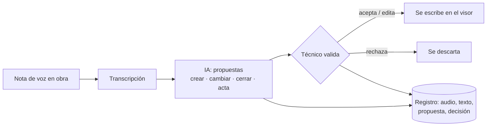
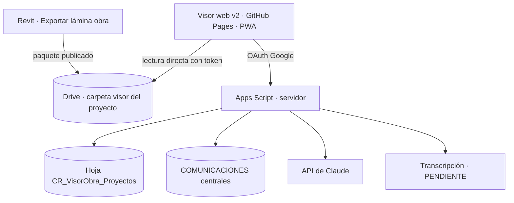

# CR_ESP_VisorObra_PO_v2.0 · Especificación del visor de obra v2

[BORRADOR IA — EN REVISIÓN]

| Campo | Valor |
|---|---|
| Documento | Especificación funcional del visor de obra CEL-RAS, versión 2 |
| Fase | PO (Proyecto en fase de Obra) |
| Responsable | BIM Manager |
| Estado | Borrador para aprobación. Las marcas **PENDIENTE** se cierran en la entrevista (parada 5) |
| Revisión | [REVISADO POR: Nombre, YYYY-MM-DD] |

## TL;DR

El visor de obra es la web donde despacho, constructora, ingenierías y propiedad ven los planos y el modelo de una obra y se comunican sobre ellos. La v1 funciona, pero ha crecido a base de parches en un único archivo.

La v2 se rehace con método, sin cambiar lo que ya va bien:

- **Mismo origen.** Los planos y modelos siguen saliendo de Revit con «Exportar lámina obra».
- **Mismo servidor.** Google Drive y Apps Script, con la misma hoja de proyectos.
- **Móvil ligero.** En el móvil solo se ven las comunicaciones y las imágenes que cada una enseña. Ni planos ni modelo 3D, porque lo ralentizan.
- **Tablet y ordenador completos.** En tablet se prueba primero.
- **Voz con IA.** El técnico dicta en obra; la IA propone crear, cambiar o cerrar incidencias y redacta el acta de la visita. Nada se guarda hasta que el técnico lo valida.

## 1. Contexto y punto de partida

### 1.1 Qué hay hoy (v1)

```
Revit (pyRevit · BIMManager_RevitExtension · panel WIP)
 └─ «Exportar lámina obra» v0.19 + «Publicar sin supervisión»
      └─ publica en la carpeta del visor del proyecto (Drive)
           ├─ láminas: PDF + JSON de localización plano↔modelo + .crimg en teselas
           ├─ índice de láminas y versiones
           ├─ IFC del anfitrión + vínculos federados (con posiciones)
           ├─ _PROPS.json.gz (propiedades de Revit)
           └─ marca de publicación completa (todo o nada)

Servidor · Apps Script «CR_VisorObra_Servidor» v0.17
 ├─ hoja CR_VisorObra_Proyectos (código · nombre · carpeta · activo · JP)
 └─ COMUNICACIONES centrales (libro, fichas PDF, adjuntos, capturas, copias diarias)

Visor web v0.23 · GitHub Pages · PWA (index.html + sw.js + manifest + icons/ + lib/)
```

### 1.2 Por qué rehacerlo

- Todo el visor vive en un único `index.html`. Cada cambio arriesga romper otra parte.
- No hay pruebas automáticas; los fallos se descubren en obra.
- La lentitud viene de la latencia de Apps Script, de las descargas desde Drive y del trabajo en el dispositivo, sobre todo en móvil.
- Faltan la voz con IA y el acta de obra.

### 1.3 Qué se conserva

El contrato de publicación de Revit, la hoja de proyectos, la carpeta central de COMUNICACIONES, el inicio de sesión con Google y el alojamiento en GitHub Pages. Las comunicaciones creadas con la v1 se tienen que poder leer en la v2.

## 2. Usuarios y permisos

| Rol | Ve | Puede |
|---|---|---|
| JP del despacho | Sus proyectos | Todo lo de la DF, más organizar y eliminar planos |
| DF (dirección facultativa) | Sus proyectos | Crear incidencias, consultas y órdenes; validar propuestas de IA; generar actas |
| Constructora | Proyectos invitados | Ver, responder, crear incidencias y consultas |
| Ingenierías | Proyectos invitados | Ver, responder, crear consultas |
| Propiedad | Proyectos invitados | Ver y responder. **PENDIENTE**: si puede crear consultas |
| BIM Manager | Todo | Administrar proyectos y acceder al archivo central de COMUNICACIONES |

Quien no tiene permiso no ve ni el nombre del proyecto.

## 3. Alcance funcional

### 3.1 Núcleo (paridad con la v1)

- Lista de proyectos según permisos.
- Planos por versión, con su organización por carpetas.
- Modelo 3D federado con propiedades de Revit.
- Localización plano↔modelo.
- Comunicaciones: incidencias, consultas y órdenes, con nubes o capturas sobre plano, fotos y adjuntos. Tienen estados, responsable y plazo.
- Archivo central de comunicaciones con copia diaria.

### 3.2 Modo por dispositivo

| | Ordenador | Tablet | Móvil |
|---|---|---|---|
| Planos | Sí | Sí (**PENDIENTE** de prueba de rendimiento) | No |
| Modelo 3D | Sí | Sí (**PENDIENTE** de prueba de rendimiento) | No |
| Comunicaciones | Sí | Sí | Sí |
| Imagen del plano de cada incidencia | Sí | Sí | Sí, recorte PNG |
| Imagen del modelo de cada incidencia | Sí | Sí | Sí, captura PNG |
| Notas de voz | Sí | Sí | Sí |
| Sin cobertura | Abre lo ya cargado | Abre lo ya cargado | Lee y responde; envía al volver la red |

- **Detección.** El modo se elige por el ancho de pantalla, y el usuario puede pedir «versión completa» a mano.
- **Recortes.** Al crear una incidencia sobre un plano o el modelo, se guarda una imagen del área (unos 1200 px). Es lo único que descarga el móvil.

### 3.3 Voz → propuestas → validación



1. **Grabar.** El técnico graba una nota de voz desde la obra, asociada al proyecto y a la visita del día.
2. **Transcribir.** Claude no transcribe audio. **PENDIENTE**: dictado del teclado del móvil para el piloto, o Google Speech-to-Text.
3. **Proponer.** El servidor envía la transcripción y las incidencias abiertas del proyecto a la API de Claude. Recibe propuestas estructuradas: crear incidencia, cambiar una existente (con su identificador), cerrar una existente, o anotar una entrada de acta.
4. **Validar.** Una bandeja «Propuestas IA» muestra cada propuesta con su texto de origen. El técnico la acepta, la edita o la rechaza.
5. **Registrar.** Se guardan el audio, la transcripción, la propuesta, la decisión y quién la tomó.

### 3.4 Acta de obra

- Se genera al cerrar la visita, a partir de las incidencias tocadas y de las entradas de acta validadas.
- Sale en formato CEL-RAS, con la etiqueta `[BORRADOR IA — EN REVISIÓN]`, y no se comparte hasta que la firma el técnico.
- **PENDIENTE**: la plantilla del acta y en qué carpeta se guarda.

## 4. Arquitectura



**PENDIENTE (ADR en la parada 11):**

- Estructura del código del visor: módulos separados con o sin paso de compilación. La recomendación es módulos ES sin compilación, para seguir publicando tal cual en GitHub Pages.
- Agrupar las llamadas al servidor al abrir un proyecto.
- Leer Drive directamente desde el navegador con el token OAuth, en lugar de pasar los archivos por Apps Script.

## 5. Criterios de aceptación

Formato Dado / Cuando / Entonces. Cada criterio debe poder fallar y dice cómo se comprueba. Las cifras marcadas «medir en p3» se miden en la parada 3 con la v1, y la v2 no puede empeorarlas.

### Permisos

- **CA-01.** Dado un usuario sin permiso en CASO-F, cuando abre el visor, entonces CASO-F no aparece en su lista y la URL directa del proyecto devuelve «sin acceso». *Se comprueba con Playwright y una cuenta de pruebas sin permiso.*
- **CA-02.** Dado un usuario de la constructora, cuando intenta eliminar un plano, entonces la opción no aparece y el servidor rechaza la llamada si se fuerza. *Playwright más una llamada directa al servidor.*
- **CA-03.** Dado un JP, cuando reorganiza las carpetas de planos, entonces los demás usuarios ven el mismo orden al recargar. *Dos sesiones de Playwright.*

### Núcleo

- **CA-04.** Dado el paquete publicado de CASO-P, cuando se abre en la v2, entonces el número de láminas, de versiones y de modelos coincide con el índice publicado. *Script independiente que cuenta el paquete en Drive.*
- **CA-05.** Dado un punto de un plano de CASO-F, cuando se pide su localización en el modelo, entonces la cámara va al mismo elemento que en la v1. *Tres puntos de control anotados en p3.*
- **CA-06.** Dadas las comunicaciones de CASO-P creadas con la v1, cuando se abren en la v2, entonces se ven todas, con sus estados, respuestas y adjuntos. *Recuento contra el libro central.*
- **CA-07.** Dada una incidencia nueva sobre un plano, cuando se guarda, entonces aparece en el libro central y en su ficha PDF con el recorte del plano. *Lectura del libro central tras la prueba.*

### Móvil, tablet y sin cobertura

- **CA-08.** Dado un móvil, cuando abre CASO-F, entonces no descarga ningún PDF, `.crimg` ni IFC. *Registro de red de Playwright en tamaño móvil.*
- **CA-09.** Dado un móvil con 4G, cuando abre una incidencia, entonces se ve con su recorte en menos de 3 s. *Medido en un iPhone y un Android reales, anotando la red.*
- **CA-10.** Dado un móvil sin cobertura, cuando responde a una incidencia, entonces la respuesta se guarda en local y se envía sola al volver la red, sin duplicarse. *Playwright en modo sin conexión.*
- **CA-11.** Dada una tablet, cuando abre CASO-F en versión completa, entonces el plano y el modelo cargan en menos de lo medido con la v1 («medir en p3»). Si no, la tablet pasa a modo ligero. *Medido en la tablet de obra.*
- **CA-12.** Dado un usuario con el móvil, cuando pulsa «versión completa», entonces ve planos y modelo. *Playwright.*

### Voz e IA

- **CA-13.** Dada una nota de voz que pide crear una incidencia, cuando se procesa, entonces aparece una propuesta en la bandeja y no se crea nada hasta que el técnico la acepta. *Prueba con el servidor de pruebas y una transcripción fija.*
- **CA-14.** Dada una nota que menciona una incidencia abierta, cuando se procesa, entonces la propuesta se refiere a esa incidencia por su identificador. *Diez notas de prueba con respuesta esperada escrita antes.*
- **CA-15.** Dadas diez notas de prueba, cuando se procesan, entonces al menos 8 propuestas se aceptan sin editar. *Recuento en el registro.*
- **CA-16.** Dada una propuesta rechazada, cuando se consulta el registro, entonces constan el audio, la transcripción, la propuesta, la decisión y quién la tomó. *Lectura del registro.*
- **CA-17.** Dado un usuario de la constructora, cuando intenta validar una propuesta de IA, entonces no puede. *Playwright.*

### Acta

- **CA-18.** Dada una visita con incidencias tocadas y entradas de acta validadas, cuando se genera el acta, entonces recoge todas, lleva la etiqueta de borrador y no se comparte hasta la firma del técnico. *Comparación con la lista de la visita.*

### Fiabilidad

- **CA-19.** Dada una publicación incompleta (sin marca), cuando se abre el proyecto, entonces el visor sigue mostrando la última publicación completa y avisa. *Paquete de prueba sin marca.*
- **CA-20.** Dado cualquier error del servidor, cuando ocurre, entonces el usuario ve un mensaje entendible y el error queda registrado con hora y usuario. *Error forzado en el servidor de pruebas.*

## 6. Riesgos conocidos

| Riesgo | Efecto | Primera respuesta |
|---|---|---|
| Latencia de Apps Script (0,5–3 s por llamada) | Visor lento al abrir proyectos | Agrupar llamadas; medir en p3 |
| Drive no es una CDN | Descargas lentas de planos y modelos | Lectura directa con token; caché de versiones publicadas |
| Federación de 22 vínculos en CASO-F | Memoria y tiempo en tablet | Carga por modelo; medir pronto con CASO-F |
| Inicio de sesión de Google en iPhone | Usuarios sin acceso en obra | Probar en iPhone real en el primer paso |
| App de Google en modo prueba | Límite de usuarios externos | **PENDIENTE**: publicarla o verificarla antes del piloto |
| Calidad del dictado con ruido de obra | Propuestas pobres | Plan B con Google Speech-to-Text |
| Coste de la API de Claude | Gasto no previsto | Límite mensual y registro de uso por proyecto |
| Cambio de dominio futuro (<dominio propio del despacho>) | Reinstalar la PWA y rehacer OAuth | Decidirlo antes del despliegue |

## 7. Fuera de alcance de la v2

- Editar o corregir los modelos o los planos desde el visor.
- Presupuestos, mediciones y certificaciones.
- Detección de colisiones.
- Cambiar el contrato de publicación de Revit (si hiciera falta, va en una tarea aparte).
- Mover los archivos pesados a otro almacenamiento con CDN. Se estudia en 2027 con las medidas de la v2.
- La migración a la cuenta dedicada <cuenta dedicada del despacho>.

## 8. Preguntas abiertas para la entrevista (parada 5)

1. ¿Puede la propiedad crear consultas o solo responder?
2. ¿Transcripción con el dictado del móvil o con Google Speech-to-Text?
3. ¿Plantilla del acta de obra y carpeta donde se guarda?
4. ¿Plazos de respuesta por tipo de comunicación?
5. ¿Se publica la app de Google antes del piloto?
6. ¿Pruebas en la copia de CASO-P y CASO-F o en proyectos de prueba creados desde cero?
